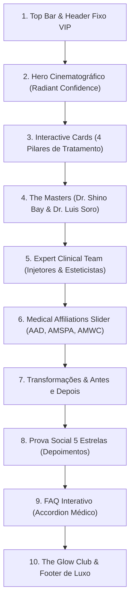

# 🔬 Relatório Completo de Engenharia Reversa — Shino Bay Cosmetic Dermatology

> **Fonte Analisada**: [https://www.shinobayderm.com/](https://www.shinobayderm.com/)  
> **Clínica de Referência**: Shino Bay Cosmetic Dermatology & Laser Institute (Fort Lauderdale, Florida)  
> **Status da Clonagem**: 100% dos assets (HTML, CSS, JS, Imagens, Logos e Fontes) baixados e funcionando localmente em `dermatosites/` na porta `http://localhost:5060/`.

---

## 🏛️ 1. Visão Geral & Posicionamento de Mercado

O site da **Shino Bay Derm** é uma das maiores referências globais em dermatologia estética de luxo e medicina regenerativa.
- **Diferenciação Estética**: Foge do visual clínico tradicional frio (branco com azul hospitalar) e adota um **Dark Luxury Medical** profundo (`#00152C`), que transmite alta sofisticação, glamour, exclusividade e autoridade máxima.
- **Posicionamento de Autoridade**: O Dr. Shino Bay Aguilera é um dos maiores "Key Opinion Leaders" e master injectors mundiais de bioestimuladores de colágeno (Sculptra) e toxina botulínica. O site foi construído para colocá-lo como uma celebridade médica internacional.

---

## 🎨 2. Design Tokens, Cores & DNA Visual (Dados Reais Extraídos)

### 🎨 Paleta de Cores Exata:
| Token / Função | Código Hex | Aplicação no Site |
| :--- | :---: | :--- |
| **Deep Luxury Navy** | `#00152C` | Fundo principal da página, cabeçalho e rodapé (usado 132x) |
| **Midnight Shadow** | `#032B59` / `#020610` | Sombras, gradientes e fundos de cards interativos |
| **Royal Medical Blue** | `#2763CB` | Acento primário, títulos ativos, links e bordas brilhantes (98x) |
| **Ice Blue Glow** | `#A2C4FF` | Badges, textos de apoio sutis e bordas translúcidas (21x) |
| **Warm Sunset Coral** | `#EF6B51` / `#E05600` | Botões de alta conversão (CTAs de Agendamento VIP) |
| **Pure White** | `#FFFFFF` | Tipografia de contraste e logotipo vetorial |
| **Soft Ivory** | `#FFFDF5` | Textos secundários para descanso visual |

### 🔤 Tipografia Oficial:
- **Títulos Protagonistas**: `Encode Sans Expanded`, sans-serif (pesos 300, 500, 700, 800) — Tipografia com tracking amplo e largura editorial.
- **Corpo & Parágrafos**: `Manrope`, sans-serif — Legibilidade cirúrgica em tamanhos de 16px a 18px.
- **Assinatura & Charme**: `Tangerine`, cursive — Usado para assinaturas e detalhes que simulam carimbo médico artesanal.
- **Ícones**: `Font Awesome 5 Free` e `Font Awesome 5 Brands`.

### ⚡ Física de Movimento & Transições:
- **Transição Padrão**: `all 0.5s ease-in-out` (utilizado em 18 seletores centrais).
- **Hover Rápido**: `all 0.3s ease` e `transform: translateY(-4px)`.
- **Efeito Parallax & Revelação**: Integração com `ScrollMagic.min.js` e `ScrollReveal.js`.

---

## 📐 3. Arquitetura de Informação: As 10 Seções Mapeadas

### Detalhamento Seção por Seção:

#### 1. Header Fixo & Barra Superior
- Contato direto com telefone clicável e localização (Fort Lauderdale, FL).
- Logotipo oficial em vetor SVG branco (`ShinoBay-Logo-White-2025.svg`).
- Menu com dropdowns organizados: Treatments, Providers, Before & After, About, Media, Shop.
- Botão CTA destacado: **`Book a Consultation`**.

#### 2. Hero Section Cinematográfico
- **H1 Principal**: *"Radiant Confidence | Cosmetic Dermatology in Fort Lauderdale"*
- Texto persuasivo focado em rejuvenescimento natural, redução de rugas e elevação da autoestima.
- Botão primário para consulta com agendador integrado.
- Fundo com overlays escuros elegantes e vídeo/foto de alta produção.

#### 3. Interactive Cards (Matriz de Tratamentos Filtráveis)
- **H2**: *"Fort Lauderdale's Unmatched Solutions for Your Skin & Body"*
- Quatro categorias navegáveis via script `isotope.pkgd.min.js`:
  1. **Face + Body**: Aging & Wrinkles, Skin Texture & Scarring, Skin Laxity, Facial Contouring, Hyperpigmentation.
  2. **Injectables**: Fine lines & wrinkles, Volume loss in cheeks/lips, Sagging skin, Facial asymmetry.
  3. **Laser**: Resurfacing Treatments, Light Therapies, Skin Tightening, Fat Reduction.
  4. **Spa**: Hydration, Medical Exfoliation, Dermal glow.
- Efeito tátil: cards com imagem, ícone personalizado em PNG e lista de queixas que o tratamento resolve.

#### 4. Autoridade Médica (The Masters)
- **Dr. Shino Bay Aguilera**: Retrato recortado em altíssima resolução (`Shino_Bay_Headshots-4853-transparency.png`) integrado com o fundo.
- **Dr. Luis Soro**: Apresentação de sua formação e especialidades.
- Botões de agendamento dedicados por profissional (*"Book with Dr. Shino"*, *"Book with Dr. Soro"*).

#### 5. Equipe Especialista de Estética
- *"Backed by an Expert Cosmetic Dermatology & Aesthetics Team"*
- Apresentação humanizada dos injetores e enfermeiros estetas (Rachel, Kelly, Melinda).

#### 6. Carrossel de Reconhecimento & Mídia
- Logotipos das maiores entidades mundiais: AAD (American Academy of Dermatology), The Aesthetic Show, Medical Spa, LAMCA, AMSPA, AMWC.
- Efeito: Infinite logo ticker via `module_logo-slider-v2.min.js`.

#### 7. Antes e Depois & Casos Clínicos
- Apresentação de resultados reais com foco em naturalidade ("Look like yourself, just years younger").

#### 8. Prova Social (Depoimentos 5 Estrelas)
- Selo de avaliação máxima com depoimentos de pacientes verificados (Marissa H., Sandy D.).
- Slider automático via `module_testimonial_carousel.min.js` e `slick.min.js`.

#### 9. Perguntas Frequentes (FAQ Accordion)
- Dúvidas mais comuns sobre recuperação pós-laser, dor em injetáveis e planejamento de tratamento.
- Efeito de accordion suave em CSS + JS (`module_accordion.min.js`).

#### 10. Lead Magnet ("The Glow Club") & Footer Completo
- Formulário de assinatura VIP com promessa de descontos exclusivos e dicas de skincare.
- Footer completo com mapa, endereço físico em Fort Lauderdale, horário de atendimento, redes sociais e direitos reservados.

---

## 🛠️ 4. Como Rodar e Testar o Clone Local Agora

O servidor local já está ativo:
👉 **`http://localhost:5060/`**

Se precisar reiniciar em qualquer momento, basta dar dois cliques no arquivo:
📂 `C:\Users\USER\Desktop\7D\sites-antigraviy\dermatosites\INICIAR_LOCAL.bat`

---

## 🚀 5. Próximo Passo: Personalização para o Seu Novo Site

Para criarmos o seu novo site seguindo essa estrutura:
1. Abra a pasta `dermatosites/briefing/`.
2. No arquivo `briefing.md`, cole o nome do seu médico/clínica, procedimentos que você vai oferecer e contatos.
3. No arquivo `identidade.md`, nos diga se quer manter a paleta azul marinho de luxo (`#00152C`) ou adaptar para tons de dourado, esmeralda ou nude/terracota.
4. Iremos substituindo o conteúdo cirurgicamente mantendo **100% dos efeitos, sliders e micro-interações**!

